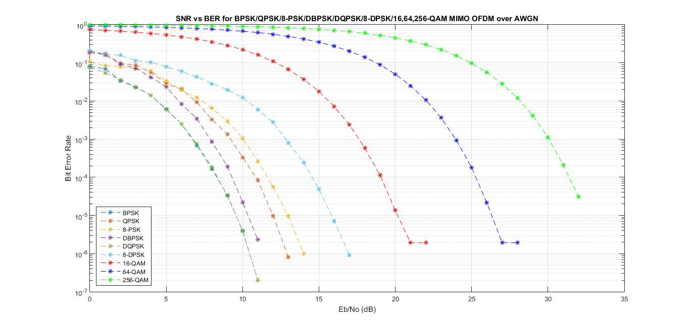
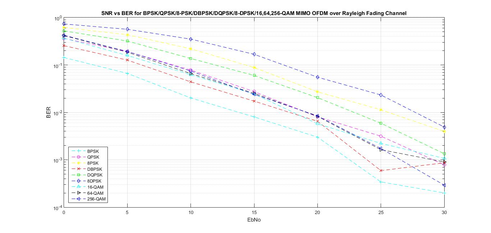
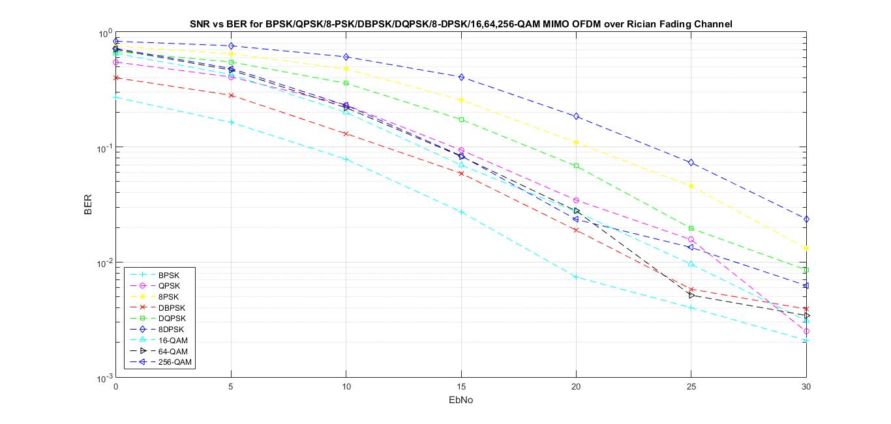

# Performance Analysis of MIMO-OFDM under Different Fading Channels

Due to the upgrade in user numbers, wireless systems require high data rates and high reliability to meet expectations. MIMO-OFDM (Multiple Input and Multiple Output Orthogonal Frequency Division Multiplexing) is considered as the best solution, considering the capability of high-speed communication services for a large number of users, fully utilizing the bandwidth. Multicarrier modulation provides the advantage of reducing intersymbol interference. The efficiency of the system varies with the channel and modulation technology. This project aims to obtain the performance of error rate versus signal-to-noise ratio efficiency. Moreover, it includes changes based on different channels, namely AWGN (Additive White Gaussian Noise), Rayleigh (Rayleigh), Rician (Rician) fading channels, and various modulation techniques (i.e., BPSK, QPSK, M-PSK, D-BPSK, DQPSK, DPSK, QAM).
\n        \n  
\n        \n  
\n        \n  

## Images

<!-- PAYMENT_BLOCK -->

## Get this dataset

- Payment link (Stripe): [Buy now](https://buy.stripe.com/3cs8yP7sY87d0vu9AB)
- Payment QR code: 

<!-- /PAYMENT_BLOCK -->
